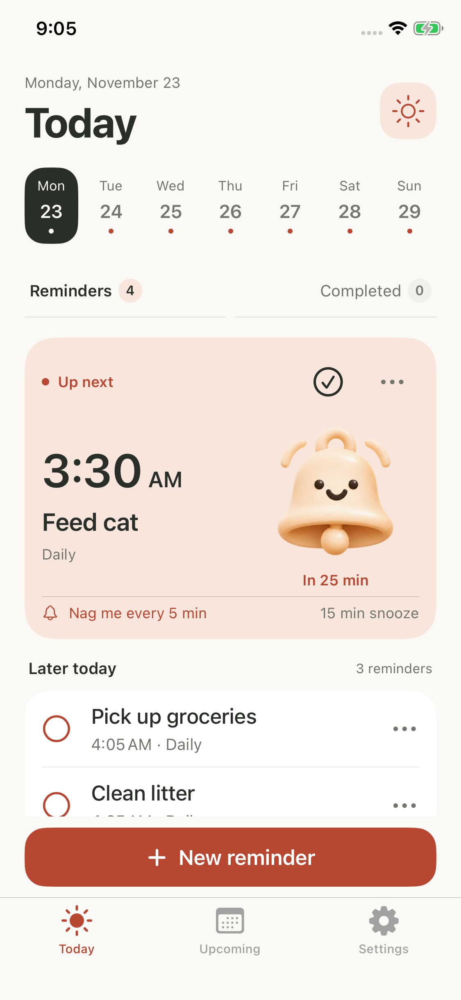
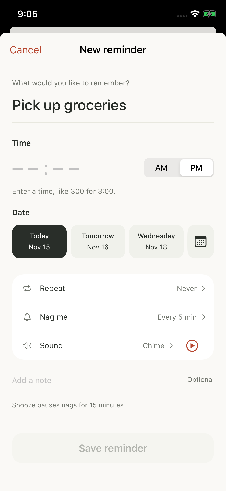
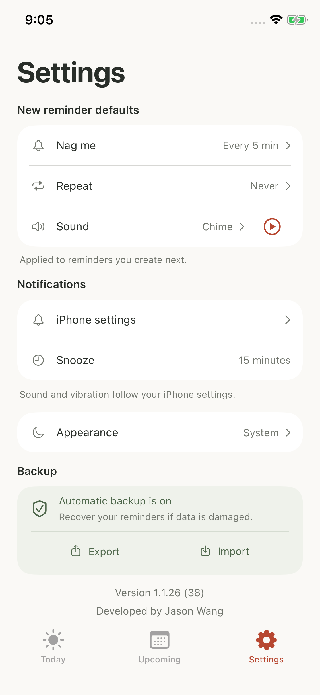
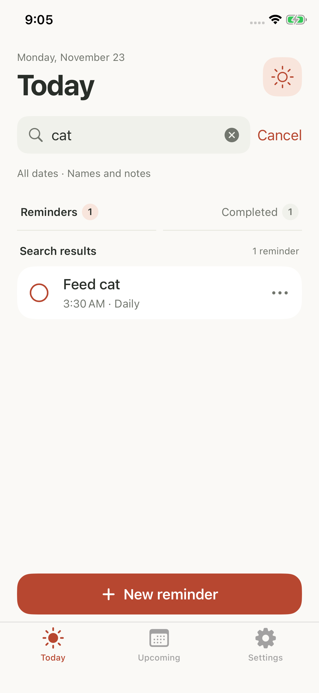
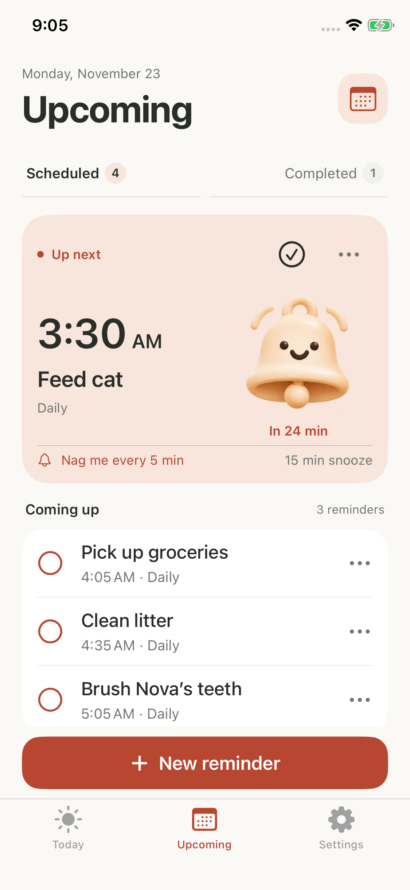
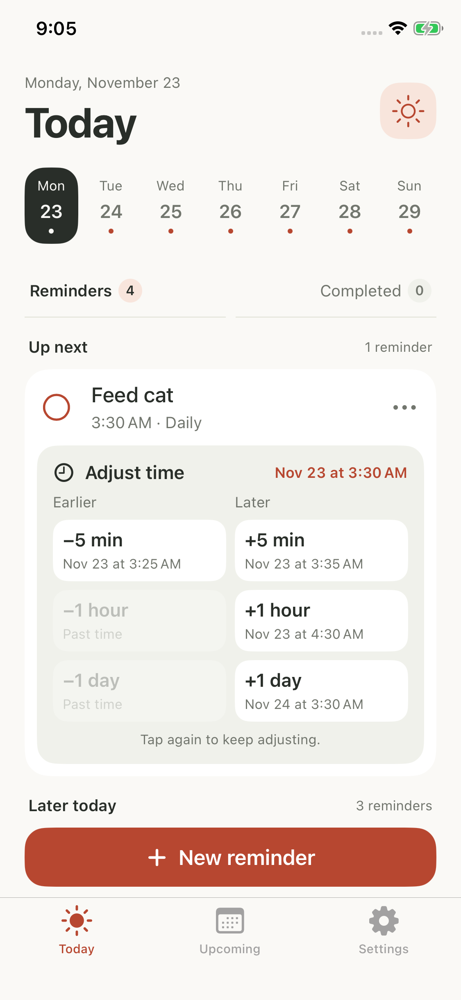
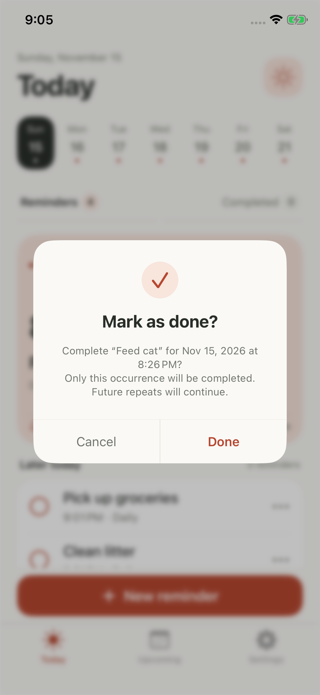
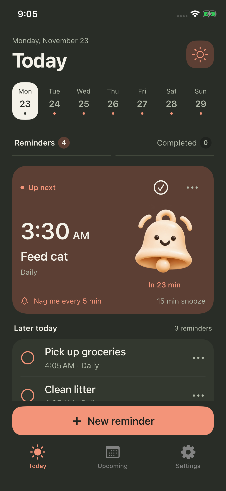

  

<h1 align="center">Nudge</h1>

<strong>Less to remember. More room for your day.</strong>

  A personal iPhone reminder app with a little personality. 
  Native SwiftUI · Local reminders · iOS 17.4+ 
  <strong>Developed by Jason Wang</strong>

  <a href="https://jasonwang224.github.io/nudge-ios/"><strong>Visit the showcase →</strong></a>
  &nbsp; · &nbsp;
  <a href="#get-nudge"><strong>Get the IPA →</strong></a>
  &nbsp; · &nbsp;
  <a href="#small-details-that-make-a-difference">Explore the features</a>
  &nbsp; · &nbsp;
  <a href="#your-reminders-protected">Backup and recovery</a>

---

Feed the cat. Make that call. Remember the thing you promised yourself you'd do.

**Give it a time, and let Nudge keep track.** A calm Today view, reminders that fit your routines, and a friendly Bell Buddy make it easier to see what's next and get on with your day.

<table>
  <tr>
    <td align="center" width="33%"><strong>Your day, at a glance</strong></td>
    <td align="center" width="33%"><strong>Ready in a few taps</strong></td>
    <td align="center" width="33%"><strong>Make it yours</strong></td>
  </tr>
  <tr>
    <td align="center"></td>
    <td align="center"></td>
    <td align="center"></td>
  </tr>
  <tr>
    <td align="center">Know what's next without hunting for it.</td>
    <td align="center">Choose a time, a routine, and a sound.</td>
    <td align="center">Your defaults. Your look. Your backup.</td>
  </tr>
</table>

Fresh native iPhone 11 Pro simulator captures from version 1.1.26 (38), using sample reminders. Screenshots show the real app UI; example titles and dates are illustrative.

## Small details that make a difference

**Find it with a keyword.** Tap the sun on Today or the calendar on Upcoming to reveal search for reminder names and notes. Results span all dates, with separate active and Completed filters. Matching ignores capitalization and accents; multiple words can match across a name and its notes. The search field stays hidden until you need it. Cancel or tap the decorative icon again to smoothly tuck it away.

<table>
  <tr>
    <td align="center" width="50%"><strong>Search when you need it</strong></td>
    <td align="center" width="50%"><strong>See beyond today</strong></td>
  </tr>
  <tr>
    <td align="center"></td>
    <td align="center"></td>
  </tr>
  <tr>
    <td align="center">Tap the decorative icon to open search. Cancel to tuck it away.</td>
    <td align="center">Find your next plans and adjust them in place.</td>
  </tr>
</table>

**A friendly face for what's next.** Bell Buddy blinks, looks around, and reacts with a little hop and wiggle when tapped. A live countdown underneath tells you how close your next reminder is.

**Type 300. See 3:00 PM.** New reminders start with a blank time field and a number pad. Select AM or PM, then tap Done to format the time and show the selected period beside it. Tap the time to edit again. The reminder-name and notes keyboards also have Done buttons that close the keyboard without saving or leaving the editor. Pick Today, Tomorrow, the upcoming weekday shortcut, or any date from the calendar.

**Keep your routines, one day at a time.** Repeat daily, on weekdays, weekly, monthly, yearly, or on selected weekdays. The Today date strip shows future occurrences too. Mark one occurrence Done—even on a future date—and the rest of the series continues. Upcoming gives you a broader view; Completed keeps your history and lets you restore an occurrence.

**Need another reminder? Set the pace.** Choose Nag Me every **1, 2, 5, 10, 15, 20, or 30 minutes**, or Off. Continuous nags can reuse one Lock Screen card per reminder while Nudge is closed, starting at the reminder time. This depends on available notification space and iOS support; see [how delivery works](#how-delivery-works).

**A little later, without starting over.** Tap a reminder row to expand its time menu. Move it earlier or later by **5 minutes, 1 hour, or 1 day**; the displayed time updates and the menu stays open for more adjustments. Tap the row again to collapse it. Full editing stays under the three dots.

**Done should feel deliberate.** Tap the completion circle to choose **Cancel** or **Done**. After confirmation, the reminder fades away and the list moves up. For a repeating reminder, only the selected occurrence is completed.

**Handle it from the Lock Screen.** **Snooze 15 min** pauses that reminder's nags; **Done** completes its current occurrence. Tap the notification itself to open the matching reminder's time menu on Today or Upcoming. The in-app completion confirmation applies to the circle button; the Lock Screen Done action completes directly.

<table>
  <tr>
    <td align="center" width="33%"><strong>Plans change</strong></td>
    <td align="center" width="33%"><strong>You have the final say</strong></td>
    <td align="center" width="33%"><strong>Easy on the eyes</strong></td>
  </tr>
  <tr>
    <td align="center"></td>
    <td align="center"></td>
    <td align="center"></td>
  </tr>
  <tr>
    <td align="center">Keep adjusting until the time feels right.</td>
    <td align="center">Finish this occurrence. Keep your routine.</td>
    <td align="center">Light, Dark, or follow your iPhone.</td>
  </tr>
</table>

| Your preference | What you can choose |
| --- | --- |
| **Defaults for new reminders** | Save your usual Nag Me interval, repeat pattern, and sound. Each reminder can have its own choices. |
| **Sounds with personality** | Chime (the default), Digital Chime, Glass, Digital Glass, Droplet, iPhone default, or Silent. Preview bundled sounds before choosing. |
| **A native feel** | Apple system typography, warm neutral colors, coral accents, animated time menus, and animated completion. |
| **Notifications by default** | New reminders have notifications enabled, with no in-app on/off switch. iPhone notification permission is still required. Settings links directly to the phone's notification controls. |
| **Your phone's clock** | Calendar routines follow the iPhone's local time zone, with handling for daylight-saving transitions. |
| **Sound and vibration** | Follow the iPhone's notification settings, Silent mode, and Focus. |
| **No account to create** | Reminders are stored on the phone and notifications are scheduled locally. No remote reminder server is needed. |

## Your reminders, protected

**Automatic recovery is built in.** Nudge keeps a verified recovery copy on the same iPhone. If the main database is missing or damaged and a valid recovery copy is available, it restores your reminders automatically. If safe recovery isn't possible, it shows a storage warning instead of silently starting with an empty list.

**Take a separate backup with you.** Settings → Backup offers **Export** and **Import** using JSON files. Export includes active and completed reminders, their individual settings, and stored completion history. Import validates the file and adds missing reminders; existing and previously deleted reminders are skipped. Your current app defaults and appearance stay unchanged.

The automatic copy is on the same device. Save an exported backup somewhere separate, such as iCloud Drive, to protect against deleting Nudge or losing the phone. The version/build number and **Developed by Jason Wang** credit appear at the bottom of Settings.

## Get Nudge

**Latest IPA: 1.1.26 (38).** Targets iOS 17.4 and later; device testing has centered on the **iPhone 11 Pro running iOS 17.4.1**.

1. Open the [latest successful IPA build](https://github.com/jasonwang224/nudge-ios/actions/workflows/ipa.yml) and download **Nudge-1.1.26-Unsigned** under Artifacts. Extract the ZIP to get the IPA. GitHub sign-in is required to download Actions artifacts; they expire after 14 days.
2. Sign and install the IPA with your preferred sideloading tool. This is an unsigned sideload build, not an App Store download.
3. Open Nudge, allow notifications, and enable Lock Screen alerts and Sounds in iPhone Settings. Choose your defaults and add a reminder.

Updating? Export a backup, then install over the existing app using the same signing account and app identifier. Open it once after installation.

[All IPA builds](https://github.com/jasonwang224/nudge-ios/actions/workflows/ipa.yml) · [Build script](scripts/build-ipa.sh) · [Automated checks](scripts/check-source.sh)

<strong>What's new in the latest version?</strong>

Version **1.1.26 (38)** adds a keyboard Done button for reminder names and notes. Finishing time entry displays the selected AM or PM beside the formatted time, such as 3:00 PM. Tap the time to edit it again; Done dismisses the keyboard without saving the reminder.

Version **1.1.25 (37)** restores the decorative sun and calendar icons as search buttons. Tap one to reveal the search field and keyboard; Cancel or tap it again to collapse search. The page heading stays in place, and the field is hidden by default.

Version **1.1.24 (36)** adds keyword search across reminder names and notes, including future reminders and completed history. Search results retain the existing adjustment, completion, edit, Snooze, and restore actions. Searching does not write to the reminder database or reschedule notifications.

Version **1.1.23 (35)** fixes the notification-response callback implicated in an intermittent crash when opening Nudge from an alert. Completion now runs on the main thread after action handling finishes. Automated checks passed, including 200 background-callback cases and the existing scheduling, interaction, database safety, and recovery suites. Confirming the intermittent crash is resolved on iOS 17.4.1 still requires device testing.

The latest design also includes the larger animated Bell Buddy, live countdown, redesigned editor and settings, completion confirmation, automatic recovery, and import/export. The callback fix retains the existing database and scheduling code.

<strong>How delivery works</strong>

- **Nudge can be closed.** Alerts are scheduled with iOS ahead of time. Presentation and sound still depend on notification permissions, Focus, Silent mode, and the phone's settings.
- **One card is supported, but capacity matters.** One-minute nags use one repeating scheduled entry. Other intervals use staggered hourly repeats that share a reminder's notification identifier: 2 minutes needs 30 entries; 5 needs 12; 10 needs 6; 15 needs 4; 20 needs 3; 30 needs 2. These entries keep repeating without consuming more space each hour.
- **The budget is shared across reminders.** Nudge uses a budget of 60 pending entries at a time, including reminders scheduled for future dates. When a continuous group won't fit, it can fall back to a limited queue of separate alerts, which may stack. Nudge displays a capacity warning. The fallback queue is replenished when Nudge opens or handles an action; it isn't an unlimited closed-app schedule.
- **Continuous nags use legacy/internal iOS notification interfaces.** Single-card behavior has been tested on iOS 17.4.1; support on other iOS versions isn't guaranteed. This implementation is intended for sideload testing.
- **A repeating routine advances when you finish its current occurrence.** A daily reminder can keep nagging about today's task until you complete or snooze it. Future dates in Today show planned occurrences, not a separate scheduled alarm for every date. Completing a future occurrence skips only that date when the series advances.
- **Calendar changes need care.** Open Nudge after changing the phone's calendar system. If daylight saving skips a selected time, the editor explains the adjusted time.

---

<strong>A little more headspace. A little more personality.</strong> Developed by Jason Wang

