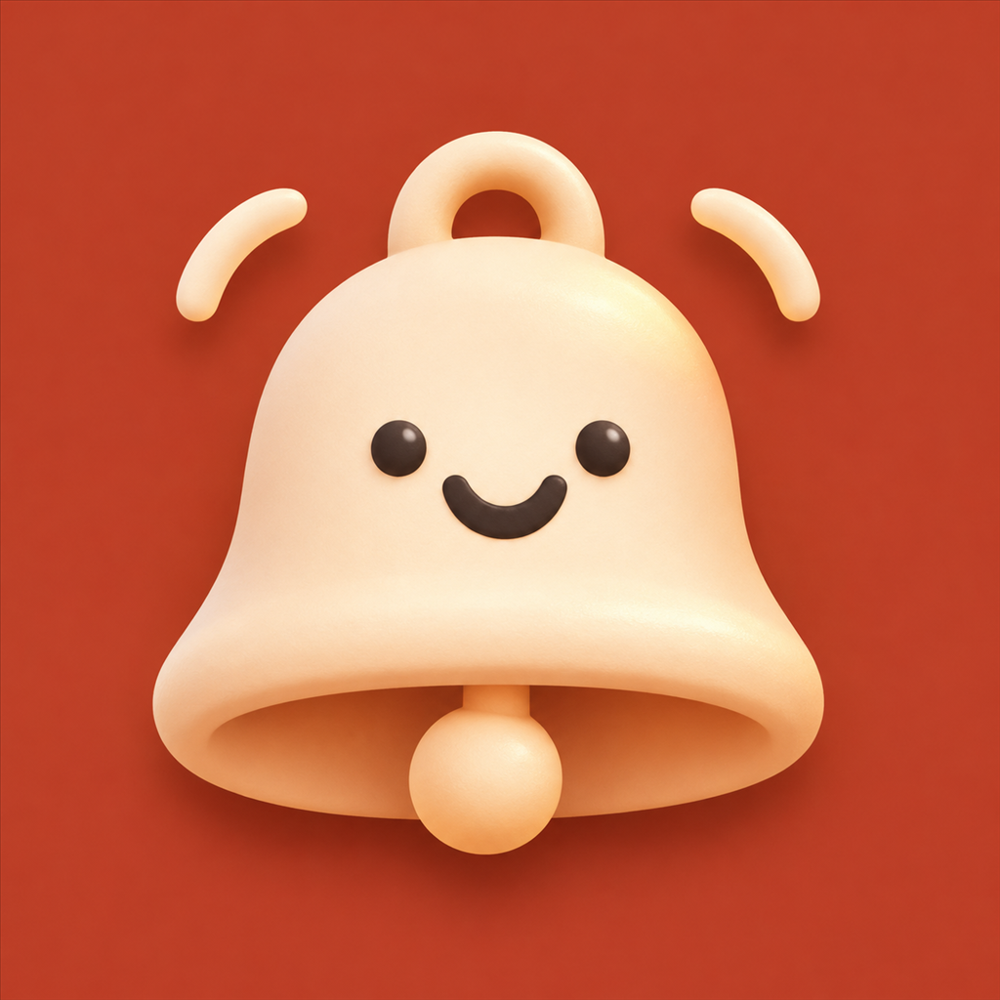
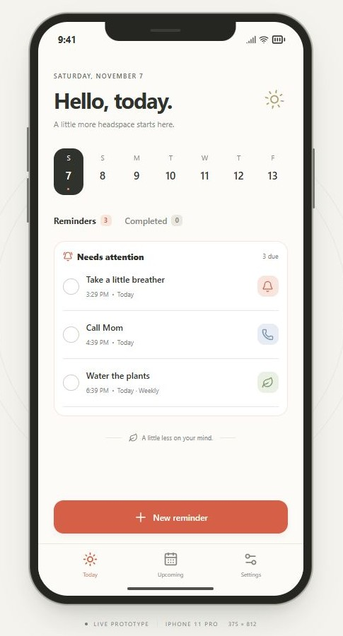
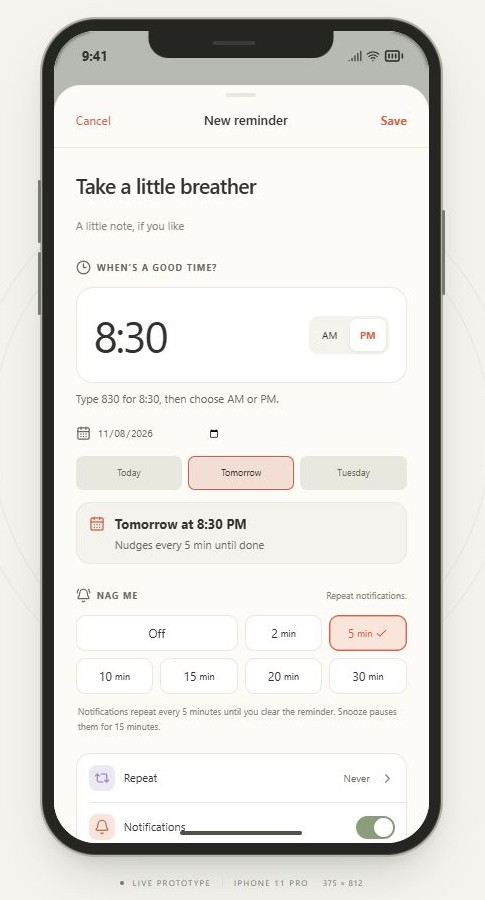
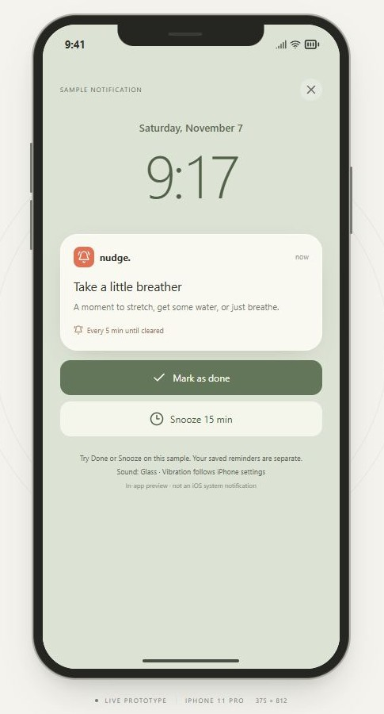

  

<h1 align="center">Nudge</h1>

<strong>A little nudge. A lighter mind.</strong>

  A beautiful, personal reminder app for the things that make up your day. 
  Native SwiftUI · iOS 17.4+ · No account needed

  <a href="#get-nudge"><strong>Get the test IPA →</strong></a>
  &nbsp; · &nbsp;
  <a href="https://nudge-reminders-studio.jasonwang224.chatgpt.site">Explore the design</a>
  &nbsp; · &nbsp;
  <a href="#the-little-details">See the features</a>

---

The call you keep meaning to make. The plants waiting for water. A moment to step away from your screen.

**Get it out of your head and into Nudge.** Set a time, choose your rhythm, and get back to your day.

<table>
  <tr>
    <td align="center" width="33%"><strong>Your day, at a glance</strong></td>
    <td align="center" width="33%"><strong>Your time. Your rhythm.</strong></td>
    <td align="center" width="33%"><strong>Done. Or a little later.</strong></td>
  </tr>
  <tr>
    <td align="center"></td>
    <td align="center"></td>
    <td align="center"></td>
  </tr>
  <tr>
    <td align="center">A calm home for everything on your mind.</td>
    <td align="center">Quick to add. Easy to make yours.</td>
    <td align="center">A small pause when life needs one.</td>
  </tr>
</table>

Images from our <a href="https://nudge-reminders-studio.jasonwang224.chatgpt.site">Sites design prototype</a>. Native screens and iOS notification appearance differ. Native Nag Me uses a finite queue; see delivery notes below. Preview access may be required.

## A reminder that fits your day

**Type 830. Choose AM or PM. You're set.** A blank time field and numeric keypad make adding reminders quick. Pick Today, Tomorrow, the upcoming weekday shortcut, or a date of your own. Add a note when the little details matter.

**Need another nudge? Choose the pace.** Nag Me schedules follow-up notifications every **2, 5, 10, 15, 20, or 30 minutes**. Choose Off for a single alert. Queued reminders can arrive with Nudge closed; see the delivery notes below.

**Keep your routines close.** Repeat daily, on weekdays, weekly, monthly, yearly, or on your own selection of weekdays. Complete the current reminder and Nudge schedules the next occurrence. In Today, you can mark a future occurrence Done and still receive the rest of the series.

**Move a reminder in a tap.** Tap a row and adjust its time by 5 minutes, 1 hour, or 1 day. The menu stays open so you can make more changes. Tap the row again to close it, or use its three dots to edit the reminder.

**Handle it from the Lock Screen.** Use **Done** to complete the current occurrence, or **Snooze 15 min** for a little breathing room. Snooze pauses that reminder's existing nags and schedules it for later.
Tap the alert itself to open the reminder’s time menu.

## The little details

| Make it yours | What Nudge gives you |
| --- | --- |
| **Your usual, every time** | Save default Nag Me, repeat, notification, and sound settings. Adjust them for any individual reminder. |
| **A sound that suits you** | Chime is selected by default. Choose Digital Chime, Glass, Digital Glass, Droplet, the iPhone default sound, or Silent. Preview the bundled sounds before choosing. |
| **A native iPhone feel** | Apple system typography, warm neutrals, coral accents, and Light, Dark, or System appearance. |
| **A clearer view of your day** | A seven-day date strip, future repeat previews, Upcoming, and clear due and snoozed states. |
| **Room for the details** | Add notes, edit a reminder, or turn its notifications off individually. |
| **A record of what you did** | Browse completed reminders and restore one when needed. Restoring a past repeat keeps the active recurring series intact. |
| **Time that follows your phone** | Schedules use your iPhone's local time zone and handle daylight-saving transitions. Snooze and nags count elapsed minutes. |
| **Familiar sound and vibration controls** | Notification vibration follows your iPhone's native settings. |
| **Your reminders stay with you** | Local storage and local iOS notifications. No Nudge account or remote reminder service required. |

## Get Nudge

**Current test build: 1.1.5 (17).** Built for iOS 17.4 and later, with testing centered on the iPhone 11 Pro running iOS 17.4.1.

1. Open the latest successful run in [Build Nudge IPA](https://github.com/jasonwang224/nudge-ios/actions/workflows/ipa.yml) and download **Nudge-1.1.5-Unsigned** from **Artifacts**. Extract the ZIP to find the IPA. GitHub sign-in and repository access are required. Artifacts are time-limited.
2. Sign and install the IPA with your preferred sideloading tool. This is an unsigned test build, not an App Store download.
3. Open Nudge, allow notifications, and enable Lock Screen alerts and Sounds in iPhone Settings. Set your defaults and add your first reminder.

Already using Nudge? Install over the existing app with the same signing account and app identifier to retain your reminders, then open it once to refresh its queued alerts.

[Build it yourself or find the release notes →](docs/DEVELOPMENT.md)

<strong>A few things to know about reminders</strong>

- **Closed app, local delivery.** Nudge hands notifications to iOS in advance, so scheduled alerts do not need the app open. Permissions, Focus, Silent mode, and scheduled delivery can affect presentation and sound. iOS controls screen wake and vibration.
- **Nag Me has a finite queue.** Nudge budgets 60 pending notifications across all reminders, prioritizes an initial alert for each active reminder, and uses the remaining slots for nags. It refills the queue when you open the app or use a notification action. Nagging is not guaranteed indefinitely without that refill.
- **More than one card can appear.** Repeated nags may leave multiple notification cards while Nudge is closed.
- **Future days are previews.** Repeating reminders appear on future dates in Today. Completing the current occurrence advances the actual scheduled series.
- **Your phone sets the clock.** Calendar-based routines follow local wall-clock time. When daylight saving skips a selected time, Nudge uses the next available time and explains the adjustment in the editor. Open Nudge after changing the phone's calendar system.
- **Test it on your device.** This is an evolving sideloaded app. Check delivery, sound, Done, and Snooze with your own iPhone settings before relying on a new build.

---

<strong>Small reminders. A little more life.</strong>

